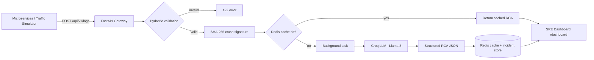

# Autonomous AI Log Triage & Root Cause Analysis Engine


> Course project for **UCS503P** (Thapar Institute of Engineering and Technology).

An event-driven log ingestion and automated incident triage pipeline for microservice architectures. It is built with **FastAPI**, **Groq LLM (`llama3-8b-8192`)** and **Redis**. The engine ingests distributed telemetry, deduplicates repeated crashes, diagnoses unseen stack traces asynchronously, and streams actionable mitigation steps to a real-time SRE incident dashboard.

---

## Table of Contents

1. [Problem Statement](#problem-statement)
2. [Features](#features)
3. [Architecture](#architecture)
4. [Tech Stack](#tech-stack)
5. [Project Structure](#project-structure)
6. [Getting Started](#getting-started)
7. [Configuration](#configuration)
8. [Usage](#usage)
9. [API Reference](#api-reference)
10. [Testing](#testing)
11. [Documentation](#documentation)
12. [Results](#results)
13. [Limitations & Future Work](#limitations--future-work)
14. [Team](#team)
15. [License](#license)

---

## Problem Statement

In microservice systems, a single failure can produce thousands of near-identical stack traces across services. On-call engineers lose time reading noisy logs, spotting duplicates and working out the root cause by hand. This project automates that first line of triage:

- Detect whether an incoming error has been seen before.
- If it is new, ask an LLM for a structured diagnosis.
- Present the result to engineers with severity and suggested fixes.

---

## Features

- **Fast ingestion gateway:** async FastAPI endpoint (`POST /api/v1/logs`) that validates telemetry against strict Pydantic schemas.
- **Automated Root Cause Analysis (RCA):** unseen crash traces trigger a background task that calls Groq's Llama 3 model. It returns a structured JSON with root cause, affected component, severity and remediation steps.
- **Crash deduplication and caching:** SHA-256 crash-signature hashing with Redis means repeated errors skip the LLM, giving sub-millisecond lookups.
- **Live SRE dashboard:** dark-mode UI at `/dashboard` with auto-polling, incident lifecycle (Open → Investigating → Resolved) and severity tracking.
- **Traffic simulator:** a standalone script that generates production-like traffic for `payment-service`, `auth-service`, `inventory-service` and `order-service`.
- **Automated tests:** `pytest` suite covering health checks, schema validation and the triage workflow.

---

## Architecture



**Request flow**

1. A service sends a log or crash event to the gateway.
2. The payload is validated, and a SHA-256 signature is computed from the normalised stack trace.
3. On a cache hit, the stored RCA is attached to the incident immediately.
4. On a miss, a background task calls the LLM, stores the structured result and updates the incident.
5. The dashboard polls the API and shows incidents with severity and remediation steps.

---

## Tech Stack

| Layer | Technology |
|---|---|
| API | FastAPI, Pydantic, Uvicorn |
| AI / LLM | Groq API, `llama3-8b-8192` |
| Cache / state | Redis |
| Frontend | HTML / CSS / JS dashboard served by FastAPI |
| Testing | pytest |
| DevOps | Docker Compose, Makefile, GitHub Actions |
| Docs | MkDocs |

---

## Project Structure

```
.
├── app/                    # FastAPI application (API, services, dashboard)
├── code/src/               # Source code area from the course template
├── scripts/                # Traffic simulator and helper scripts
├── tests/                  # pytest test suite
├── docs/                   # MkDocs documentation
├── assets/                 # Images and diagrams
├── journals/               # Weekly project journals
├── project-proposal/
├── project-report-prototype-stage/
├── project-report-final/
├── .github/workflows/      # CI pipelines
├── docker-compose.yml
├── Makefile
├── mkdocs.yml
└── requirements.txt
```

---

## Getting Started

### Prerequisites

- Python 3.10+
- Redis (local install or via Docker)
- A free [Groq API key](https://console.groq.com/)

### Installation

```bash
git clone https://github.com/Arnavsingh009/AI-Log-Analysis.git
cd AI-Log-Analysis

python -m venv venv
source venv/bin/activate        # Windows: venv\Scripts\activate
pip install -r requirements.txt
```

### Run with Docker (recommended)

```bash
docker compose up --build
```

### Run locally

```bash
# 1. start Redis
docker run -d -p 6379:6379 redis:7

# 2. start the API
uvicorn app.main:app --reload
```

Open `http://localhost:8000/dashboard` for the dashboard and `http://localhost:8000/docs` for the interactive API docs.

---

## Configuration

Create a `.env` file in the project root (never commit it):

```env
GROQ_API_KEY=your_groq_api_key
REDIS_HOST=localhost
REDIS_PORT=6379
```

---

## Usage

**Send a sample log**

```bash
curl -X POST http://localhost:8000/api/v1/logs \
  -H "Content-Type: application/json" \
  -d '{
    "service": "payment-service",
    "level": "ERROR",
    "message": "NullPointerException in checkout handler",
    "stack_trace": "java.lang.NullPointerException at com.shop.Checkout.process(Checkout.java:42)"
  }'
```

**Generate simulated traffic**

```bash
python scripts/simulator.py
```

---

## API Reference

| Method | Endpoint | Description |
|---|---|---|
| `GET` | `/health` | Service health check |
| `POST` | `/api/v1/logs` | Ingest a log / crash event |
| `GET` | `/dashboard` | Live SRE incident dashboard |
| `GET` | `/docs` | Swagger UI |

---

## Testing

```bash
pytest -v
```

Tests cover health checks, schema validation and the end-to-end triage workflow.

---

## Documentation

Full documentation is built with MkDocs:

```bash
pip install mkdocs mkdocs-material
mkdocs serve
```

Published site: https://tiet-ucs503.github.io/ucs503p-202627odd-template/

---

## Results

| Metric | Value |
|---|---|
| Cache hit lookup latency | sub-millisecond |
| LLM RCA latency (cache miss) | _add measured value_ |
| Duplicate crashes avoided | _add measured value_ |

_Add dashboard screenshots to `assets/` and embed them here:_

```markdown

```

---

## Limitations & Future Work

- Only one LLM model is supported; add model fallback and comparison.
- Redis is the only incident store; add PostgreSQL for long-term history.
- Add authentication and rate limiting on the ingestion endpoint.
- Replace dashboard polling with WebSockets or Server-Sent Events.
- Add alert integrations (Slack, email, PagerDuty).

---

## Team

| Name | Roll No. | 
|---|---|---|
| Arnav Singh | 1024160011 | 
| Siddharth Chandra |1024160011|

**Mentor:** Dr Jeelani Asif

---

## License

Distributed under the license in the [LICENSE](LICENSE) file.
